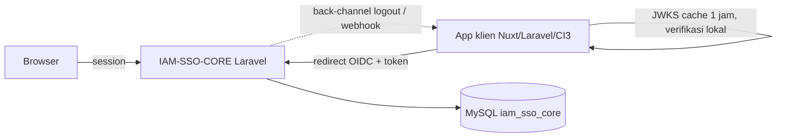

# Arsitektur IAM-SSO-CORE

## Konteks

## Lapisan
- `app/Domain/*`: logika inti, bebas dari view. Calon paket Composer.
  - `Oidc`: `KeyManager`, `TokenIssuer`, `AuthorizationService`, `TokenService`, `SessionService`, `Pkce`.
  - `Access`: `AccessResolver` (klaim per app, `can()` satu pintu untuk admin).
  - `Audit`: `AuditLogger` (insert-only).
- `app/Http`: controller tipis (`ProviderController`, `LoginController`, `Admin\AdminController`) + `EnsureIamAdmin`.
- `routes/oidc.php`: endpoint mesin tanpa session/CSRF. `routes/web.php`: alur browser dan admin.

## Endpoint
| Endpoint | Fungsi |
|---|---|
| `GET /.well-known/openid-configuration` | Discovery |
| `GET /oauth/jwks` | Public key RS256 |
| `GET /oauth/authorize` | Code + PKCE (login jika belum ada sesi SSO) |
| `POST /oauth/token` | `authorization_code`, `refresh_token` |
| `GET/POST /oauth/userinfo` | Profil dasar (Bearer) |
| `GET/POST /oauth/logout` | end_session (id_token_hint, post_logout_redirect_uri, state) |
| `/admin/*` | Panel admin (super admin) |

## Alur
1. App redirect ke `/oauth/authorize` (+ `code_challenge`). Jika belum login, IAM menampilkan `/login`, membuat `sso_sessions`, lalu mengembalikan `code` (60 detik, sekali pakai).
2. App menukar `code` + `code_verifier` di `/oauth/token`, menerima access token (15 menit, RS256), ID token, refresh token (rotasi).
3. App memverifikasi JWT lokal (JWKS), memakai `permissions` untuk otorisasi.
4. Logout: `/oauth/logout` mencabut sesi + refresh token dan memanggil back-channel semua app di sesi itu.

## ADR
| ID | Keputusan | Status |
|---|---|---|
| ADR-001 | Laravel penuh, tanpa CI3 | Diterima |
| ADR-002 | Modular monolith, domain di `app/Domain`, ekstrak ke paket nanti | Diterima |
| ADR-003 | OIDC dibangun sendiri (`firebase/php-jwt`), di belakang interface | Diterima (evaluasi ulang vs Keycloak) |
| ADR-004 | Token/kode/API key hanya disimpan sebagai SHA-256 | Diterima |
| ADR-005 | Private key RSA terenkripsi `APP_KEY`; key lama tetap di JWKS saat rotasi | Diterima |
| ADR-006 | App klien punya DB sendiri, kunci `iam_sub`, tanpa share DB | Diusulkan |

## Keamanan (ringkas)
Pesan login generik; rate limit IP + akun; regenerate session; suspended mencabut seluruh sesi; replay kode mencabut token turunan; reuse refresh mencabut keluarga token; redirect_uri exact match dan tidak pernah di-redirect jika tidak valid; audit semua aksi sensitif; super admin terakhir dilindungi.
